# 오로라 오너스 360 (Aurora Owners 360)

> **English summary**
> - A Salesforce CRM for a fictional EV maker's customer care center: it started as a car-owner complaint (VOC) app and grew into a customer-lifecycle CRM (owner · vehicle · warranty · service · compensation).
> - Built only with a free **Developer Edition**: custom objects, Flow, Apex, LWC (incl. a three.js 3D parts view), Agentforce agent and Prompt Templates (Claude Sonnet 4.6).
> - Design principle: **rules decide, AI explains** — escalation, warranty, lemon-law and recall checks are Flow/Apex; AI only summarizes and drafts, and cannot close, approve or downgrade a case.
> - Includes a customer-facing AI chat that answers simple questions with Apex data (no LLM call) and hands off to an agent with a recorded reason.
> - All people, companies and data are fictional. Design decisions by the author; implementation in collaboration with Claude Code.

전기차 회사 고객센터의 **차주 불만(VOC) 처리 앱**에서 출발해, VOC를 잘 처리하는 데 필요한 데이터를 따라 **고객 생애주기 CRM**으로 넓힌 Salesforce 프로젝트입니다. 유료 기능 없이 **Salesforce Developer Edition(무료)** 만으로 만들었습니다.

`Salesforce` `Service Cloud(Case)` `Flow` `Apex` `LWC` `Agentforce` `Prompt Builder(Claude Sonnet 4.6)` `three.js` `SFDX`

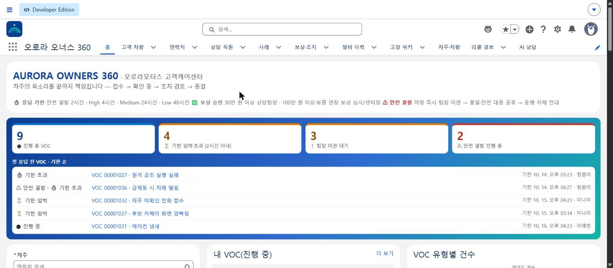

- 설계 문서: [docs/PRD.md](docs/PRD.md) (설계 결정 64개와 버전별 수용 테스트 결과)
- 화면 캡처: [docs/screenshots/v4.5/](docs/screenshots/v4.5/)

---

## 1. 문제: 자동차 고객센터의 VOC

**오로라모터스**는 가상의 전기차 중심 완성차 회사입니다. 전기 세단 E5, 전기 SUV 노스라이트, 소형 EV 시티로, 하이브리드 GT를 팝니다. 이 회사 **고객케어센터 상담팀**이 차주의 불만을 처리하는 상황을 모델로 했습니다.

| 숫자 | 의미 |
|---|---|
| **51점** | 미국 J.D. Power 2025 조사에서 대중 전기차 서비스 만족도가 내연기관차보다 51점 낮음. 기술자·정비망이 부족하니 상담 창구가 차량 정보와 기술 지식을 대신 채워야 함 |
| **8년** | 일반 보증 3년과 별도인 배터리 보증. 충전·커넥티드카·배터리 안전처럼 차량 정보를 모르면 답할 수 없는 문의가 많음 |
| **2시간** | 브레이크·배터리 같은 안전 결함이 팀장·품질팀까지 가야 하는 시간. 실제 리콜 지연·화재 사태의 공통 원인은 *현장 불만 신호가 위로 늦게 올라간 것* |

이 앱이 풀려는 문제는 세 가지입니다.
1. **정보가 흩어져 있다**: 차주·차량·보증·정비·보상 이력을 여러 화면에서 찾아야 함 → **한 화면에 모은다**
2. **안전 신호가 늦게 올라간다**: 사람이 판단해서 이관하면 누락·지연이 생김 → **저장하는 순간 자동 이관하고, 같은 결함이 모이면 리콜 경보를 낸다**
3. **전기차 상담은 기술 지식이 필요하다**: 배터리 보증, 레몬법 같은 판단이 필요함 → **규칙으로 자동 판정한다**

### 누가 쓰나
| 역할 | 하는 일 |
|---|---|
| **상담원 (주 사용자)** | VOC 접수, 차량·보증 확인, 첫 응답, 보상 요청, 종결 |
| 상담팀장 | 이관된 VOC 처리, 30만~100만 원 보상 승인 |
| 고객케어센터장 | 100만 원 이상·보증 연장 승인, 현황 지표 확인 |
| EV 기술 상담 / 보상 심사 / 품질·안전 대응 / 서비스센터 협력 | 충전·배터리 진단 / 고액 보상 심사 / 리콜 경보·고장 위키 검토 / 정비 연계 |
| 차주 | AI 상담으로 본인 확인 후 정보 조회·셀프 해결 또는 상담사 연결 |

**상담원의 하루**: 홈에서 기한이 급한 VOC부터 확인 → 안전 결함은 이미 팀장에게 넘어가 있음 → VOC를 열면 위험 점수·반복 결함·레몬법 가능성이 한눈에 보임 → 요약·유사 사례는 AI에게 맡김 → 보상 승인을 받아 종결

---

## 2. 왜 VOC 앱에서 고객 생애주기 CRM으로 넓혔나

```
구매·출고 ──▶ 보유·정비 ──▶ [문제·VOC] ──▶ 보상·해결 ──▶ 재구매·추천
   v3            v3          v1 출발점         v2·v3          v5 예정
                             v4 AI·리콜
                             v4.1~v4.4 AI 상담·알림
```

1. **가장 아픈 접점부터**: VOC는 고객 이탈, 안전 사고, 법적 분쟁이 몰리는 곳입니다. 그래서 MVP는 *"상담원 1명이 VOC 1건을 끝까지 처리"* 로 잡았습니다(v1).
2. **VOC 질문을 따라가다 보니 데이터가 넓어졌다**:
   - "보증 기간 안인가?"를 답하려면 출고·보증 데이터가 필요합니다.
   - "처음 고장인가?"를 답하려면 정비 이력이 필요합니다.
   - "차주가 누구인가?"를 답하려면 차량-사람 관계가 필요합니다.
3. **실제 기업도 같은 길을 갔다**:
   - **기아**는 Service Cloud로 흩어진 고객 정보를 모으고 VOC 관리를 고도화했습니다. → 오로라는 차주 → 차량 → VOC → 보상으로 이어지는 관계 모델을 가져왔습니다.
   - **현대 북미 'Connex'** 는 Automotive Cloud로 수십 개 시스템을 하나로 묶어 Driver 360(고객 한 화면)을 만들었습니다. → 오로라는 차주 360 카드와 통합 타임라인을 가져왔습니다.
   - **Mercedes-Benz 고객지원센터**는 상담원이 서비스 이력을 바로 보게 했습니다. → 오로라는 VOC 한 화면에 차주·차량·보증·정비 이력을 모았습니다.

이 프로젝트의 핵심은 기능 개수가 아닙니다. **처음부터 확장할 수 있게 데이터 모델을 설계한 것**입니다. 유료 Automotive Cloud 없이 같은 구조를 직접 모델링했습니다.

| 버전 | 주제 | 대표 기능 |
|---|---|---|
| v1 | VOC 처리 기본 | 차량·보상·직원 오브젝트, 안전 결함 자동 이관 Flow, VOC 진행 단계(Path) |
| v2 | 업무판·승인 | 오로라 홈, 빠른 VOC 접수, 보상 2단계 승인, 리포트 3개 |
| v3 | 고객 생애주기 데이터 | 모델·보증·정비·부품·고장 위키, 레몬법 판정, 차주 360 타임라인 |
| v3.5 | 브랜드·가독성 | 로고·색, 상황 카드·배지, 보증 게이지, 차량 3D 분해도 |
| v4 | AI 업무 위임 | Agent "VOC Care Assistant", Prompt Template 3개, 리콜 조기 경보 |
| v4.1 | 고객용 AI 상담 | 본인 확인 → 규칙 판정 → 셀프 해결 또는 상담사 연결 |
| v4.3 | AI 상담 고도화 | 단순 정보 문의(보증·점검·진행 상황 등)는 Apex 데이터로 답하고 AI 호출 0회 |
| v4.4 | 현장 피드백 반영 | 부품 공급사·담당자, '차주·차량' 통합 탭, 업무 알림(이관·승인·기한·AI 연결), 과거 해결 사례 기반 AI 해결 가이드(RAG) |
| v4.2 | 어디서든 쓰는 Agent | VOC 번호·번호판·차주 이름으로 대상 찾기, 진행 중·기한 임박·안전 결함 등 업무 조회 |
| v4.5 | 공개 준비 | 가상 인물 이름 정리, 담당자를 이름 대신 역할로 조회, 중복 규칙 공용화, 시연 데이터 정리 |
| v5·v6 예정 | 재구매·성과 | 리콜 캠페인, 재구매 상담, 대시보드, 고장 히트맵 |

---

## 3. 아키텍처와 데이터 모델

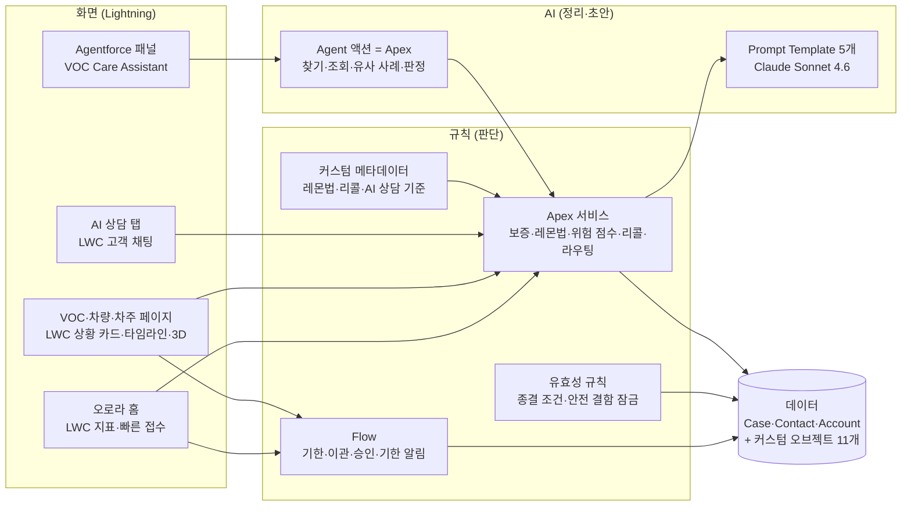

AI는 규칙이 판단한 결과와 레코드 값만 받아 문장을 만듭니다. 판정·이관·승인·종결은 Flow·Apex·유효성 규칙이 하고, Agent에는 이런 변경 액션이 없습니다.

신규 커스텀 오브젝트 11개 + 표준 오브젝트 3개(Contact 차주·공급사 담당자, Account 가구·법인·공급사, Case VOC)

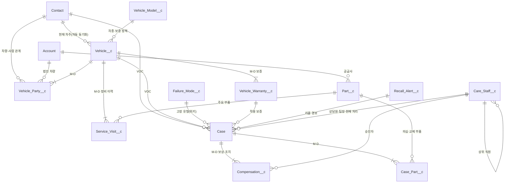

### 설계에서 고민한 결정
| 고민 | 선택 | 이유 |
|---|---|---|
| VOC를 새 오브젝트로? | **표준 Case 재사용**, 표준 Status 대신 별도 `VOC_Status__c` | 고객 연결·우선순위·리포트는 그대로 쓰고, 같은 환경의 다른 앱이 쓰는 Case 동작은 건드리지 않음 |
| 보상은 Lookup? Master-Detail? | 보상 → VOC **Master-Detail**, 차량 → 차주 **Lookup(SetNull)** | VOC 없는 보상은 없고 승인 금액 합계를 롤업해야 함. 차주가 지워져도 차량 이력은 남아야 함 |
| 직원을 사용자(User)로? | 레코드 `Care_Staff__c` + 자기 참조 상위 직원, 담당자는 **역할(`Role__c`)로 조회** | Developer Edition 사용자 라이선스는 2개뿐 → 직원 10명을 레코드로 표현. 코드에 사람 이름을 넣지 않아 인사 이동에도 코드 수정 없음 |
| 금액 타입 | Currency 대신 **Number(16,0)** + 라벨 "금액(원)" | Currency는 환경 로캘에 따라 $로 표시됨 |
| 계산값은 수식? 저장? | 한 레코드 안 계산은 **수식**, 여러 레코드 판정(레몬법·반복 결함·위험 점수)은 **Apex가 저장** | 저장해 두면 리스트 뷰·리포트·AI가 같은 값을 씀 |
| 같은 규칙이 두 곳에 | 보상 승인 단계는 수식(화면·리포트용) + Apex 공용 클래스 하나, **테스트로 두 기준이 같은지 확인** | 기준이 갈라지는 것을 테스트가 잡음 |
| 차주는 필드 하나? | **`Vehicle_Party__c`(소유자·주 운전자·리스 이용자·이전 소유자 + 기간)가 원본**, 차량의 차주 필드는 자동 동기화 | 중고 거래·법인 차량을 표현하면서 기존 화면·리포트는 그대로 |
| 보증은 날짜 수식? | v1 수식 → v3 **`Vehicle_Warranty__c` 레코드**(기간 + 주행거리 중 먼저 도달) | "3년 또는 6만km"와 보증 연장은 수식으로 표현 불가 |
| 바뀌는 기준값 | **커스텀 메타데이터** `Lemon_Law_Rule__mdt`·`Recall_Rule__mdt`·`Aicx_Rule__mdt` | 법령·정책이 바뀌면 코드 배포 없이 레코드만 수정 |
| 샘플 데이터 중복 | External ID: `VIN__c`·`VOC_Key__c`·`Staff_Number__c` 등 | 다시 적재해도 upsert로 중복 없음 |

---

## 4. 업무 흐름과 자동화

| 단계 | 자동화 |
|---|---|
| **접수** | Before-save Flow `VOC_Case_Before_Save`: 응답 기한(안전 2h · High 4h · Medium 24h · Low 48h). 안전 결함·기한 초과·도움 요청이면 **현재 처리 직원 = 팀장, 이관 상태·사유·시각 기록** |
| **확인 중** | 차주·차량 없으면 진행 불가(유효성 규칙). Apex: 보증 판정, 반복 결함, 레몬법, 고객 위험 점수, 유사 사례 상위 3건 |
| **조치 검토** | 보상 승인: 30만 원 미만 바로 / 100만 원 미만 팀장 / 그 이상·보증 연장은 보상 심사·센터장(Screen Flow 버튼) |
| **종결** | 첫 응답 없음·미승인 보상·고장 유형 없음이면 종결 불가 |
| **패턴** | 같은 모델·같은 계통 안전 결함 90일 2건 → Apex가 **리콜 조기 경보** 생성(품질·안전 대응 담당 + 벨 알림 + 홈 경보 띠) |
| **알림** | 팀장 이관·보상 승인 요청·AI 상담 연결은 저장 즉시, 첫 응답 기한 임박·초과는 Flow 예약 경로로 벨 알림 |

**설계 원칙: 판단은 규칙이, 정리는 AI가.**
- 이관·판정은 Flow와 Apex가 합니다.
- AI(Agentforce·Prompt Template)는 결과를 사람이 읽기 좋게 정리합니다.
- Agent에는 종결·승인·유형 변경 액션이 없습니다.
- 안전 결함 유형은 팀장 이관이 '처리완료'되기 전에는 사람도 AI도 바꿀 수 없습니다(유효성 규칙 `Aurora_Safety_Category_Locked`).
- 고객용 AI 상담은 정보 조회를 Apex 데이터로 답하고(AI 호출 0회), 문제 문의만 고장 위키를 근거로 AI가 안내합니다.

---

## 5. 화면

인물·회사·데이터는 모두 가상입니다.

### ① VOC 한 화면 — 상황 카드, 진행 단계, 유사 사례
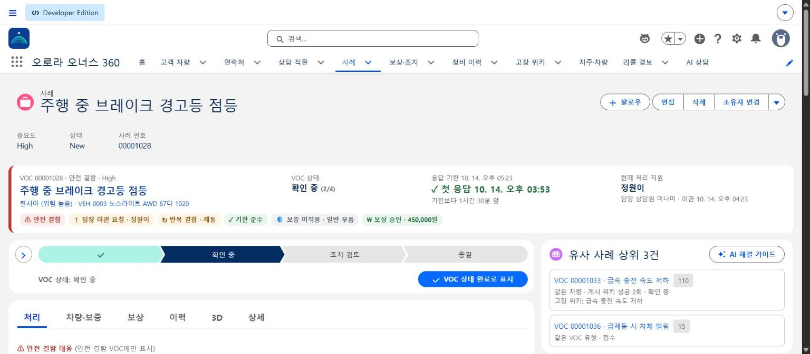

안전 결함 VOC는 저장하는 순간 Flow가 현재 처리 직원을 팀장으로 바꾸고 기한을 2시간으로 잡습니다. 상황 카드에는 안전 결함·팀장 이관·반복 결함·기한 준수·보증·보상 금액이 배지로 보입니다. 배지는 색과 함께 아이콘·글자로 의미를 전달합니다.

### ② 3D 부위 분해도
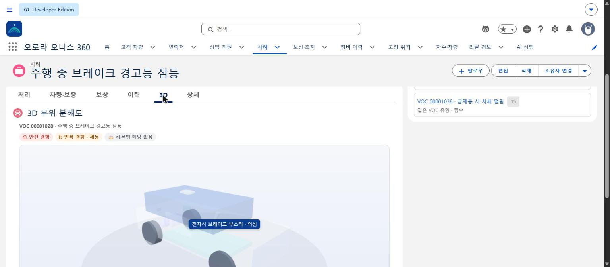

VOC에 연결된 의심 부품(전자식 브레이크 부스터)이 차량 3D 모델에서 표시됩니다. three.js를 정적 리소스로 올려 LWC에서 그립니다.

### ③ 차량 — 품질 신호, 보증 게이지, 통합 타임라인
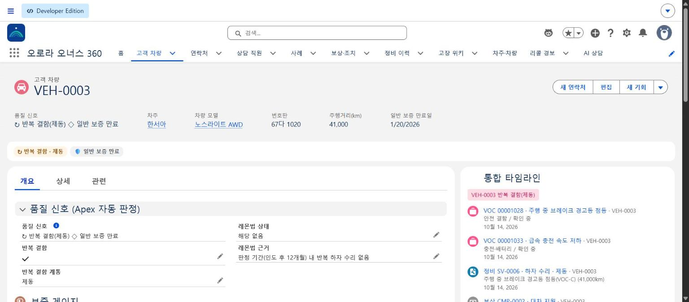
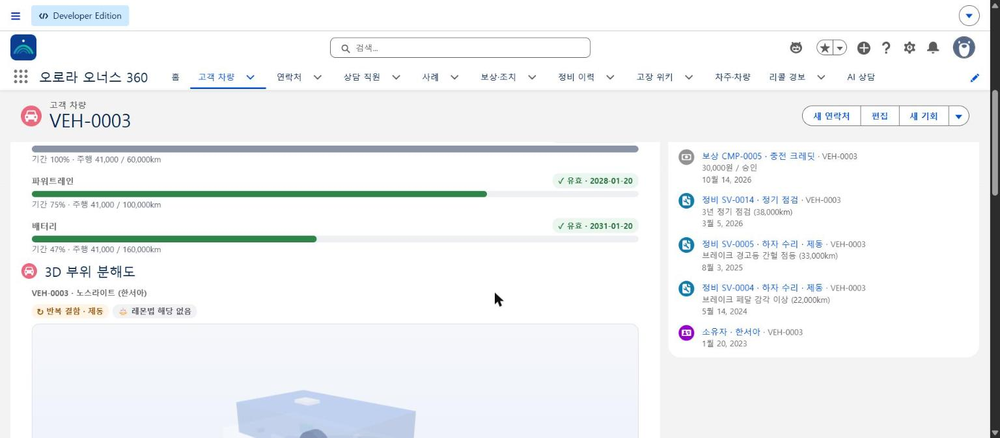

반복 결함·레몬법 상태는 Apex가 정비 이력으로 판정해 저장합니다. 보증은 기간과 주행거리 중 먼저 닿는 쪽을 기준으로 게이지에 표시하고, VOC·정비·보상·소유 이력을 한 타임라인으로 보여 줍니다.

### ④ 차주·차량 보드
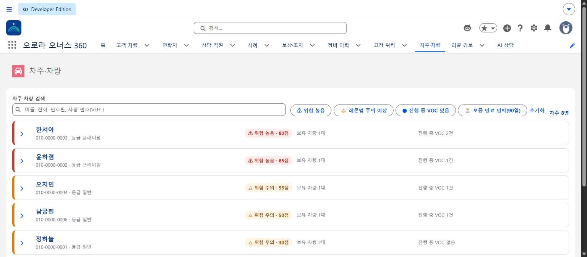

차주를 위험 점수 순으로 보고 위험 높음·레몬법 주의·진행 중 VOC·보증 만료 임박으로 거릅니다.

### ⑤ 보상 2단계 승인
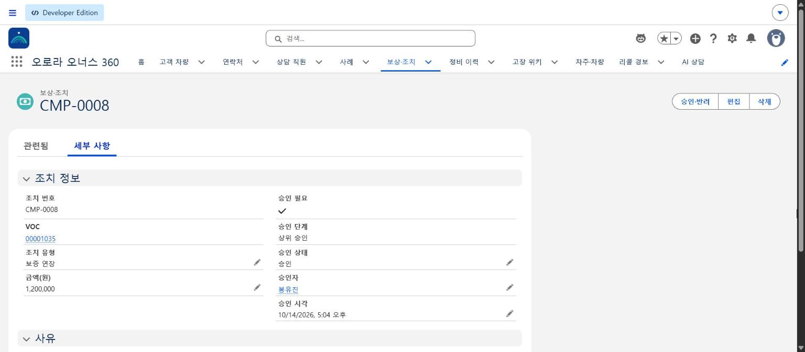

금액과 유형으로 승인 단계가 정해지고(120만 원 보증 연장 → 상위 승인), 권한 없는 승인자는 유효성 규칙이 막습니다.

### ⑥ Agentforce — VOC Care Assistant
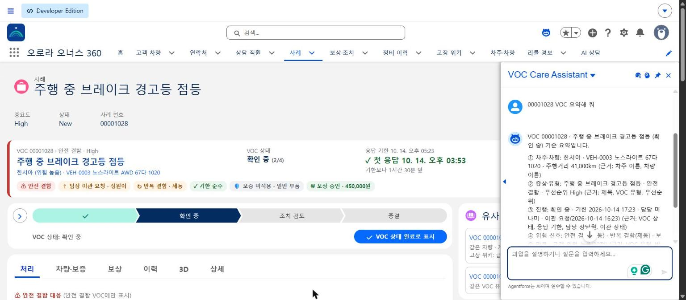

"00001028 VOC 요약해 줘"처럼 VOC 번호·번호판·차주 이름으로 대상을 찾고, 근거 필드를 붙여 요약합니다. "종결 처리해 줘" 같은 변경 요청은 사람만 할 수 있다고 안내합니다.

### ⑦ 차주용 AI 상담
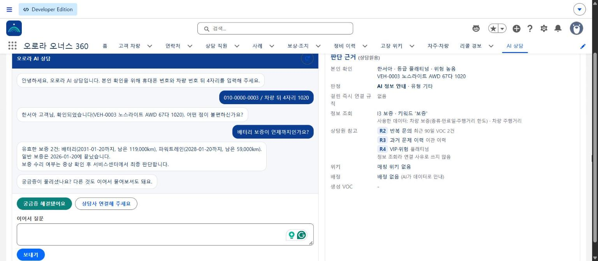

- 휴대폰 번호와 차량 번호 뒤 4자리로 본인을 확인합니다.
- 보증·점검·진행 상황 같은 정보 문의는 Apex가 데이터로 답합니다(AI 호출 없음). 오른쪽 '판단 근거'에 어떤 데이터와 규칙을 썼는지 남습니다.
- 안전 키워드·반복 문의·화남·사람 요청 등 즉시 연결 규칙에 걸리면 상담사에게 연결하고 이유를 기록합니다.

### ⑧ 오로라 홈
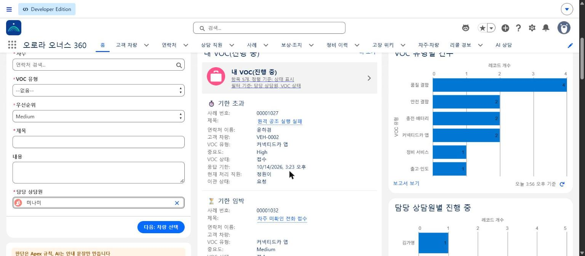

빠른 VOC 접수(Screen Flow), 내 VOC, VOC 유형별·상담원별 리포트 차트를 한 화면에 둡니다.

---

## 6. 설치 (다른 Developer Edition에 다시 만들기)

> **검증 상태**: 메타데이터·생성 스크립트·샘플 데이터는 모두 이 저장소에 있지만, **새 org에 처음부터 설치하는 과정은 아직 검증하지 않았습니다.** 아래 순서는 개발 org에서 실제로 쓴 명령을 정리한 것입니다.

### 전제 조건
- Salesforce **Developer Edition**(Agentforce·Einstein 생성형 AI 사용 가능 버전), 설정에서 Einstein 생성형 AI와 Agentforce 켜기
- [Salesforce CLI](https://developer.salesforce.com/tools/salesforcecli)(`sf`), Python 3
- Windows에서는 `sf … --json`을 PowerShell로, 한글이 든 Python은 `python -X utf8`로 실행

### 순서
```bash
# 1. 로그인
sf org login web --alias aurora

# 2. 메타데이터 배포 (Apex 테스트 포함)
sf project deploy start -x manifest/package.xml --test-level RunLocalTests -o aurora
#    권한 세트의 Agent 접근(agentAccesses)은 Agent 게시 전이면 실패할 수 있습니다.
#    그때는 권한 세트 파일에서 agentAccesses만 잠시 빼고 배포한 뒤 4단계 후 다시 배포합니다.

# 3. 샘플 데이터 (순서대로)
sf data upsert bulk -s Care_Staff__c -f data/care-staff-1-head.csv -i Staff_Number__c --line-ending LF -o aurora
sf data upsert bulk -s Care_Staff__c -f data/care-staff-2-leads.csv -i Staff_Number__c --line-ending LF -o aurora
sf data upsert bulk -s Care_Staff__c -f data/care-staff-3-advisors.csv -i Staff_Number__c --line-ending LF -o aurora
sf data upsert bulk -s Vehicle_Model__c -f data/vehicle-models.csv -i Model_Code__c --line-ending LF -o aurora
python -X utf8 scripts/build-data.py --target-org aurora          # 실행 시각 기준으로 기한을 계산해 data/out/ 생성
sf data import tree --plan data/out/aurora-plan.json -o aurora    # 차주·차량·VOC·보상
sf data upsert bulk -s Part__c -f data/v3/parts.csv -i Part_Number__c --line-ending LF -o aurora
sf data upsert bulk -s Failure_Mode__c -f data/v3/wiki.csv -i Wiki_Key__c --line-ending LF -o aurora
sf data upsert bulk -s Service_Visit__c -f data/v3/service-visits.csv -i Visit_Key__c --line-ending LF -o aurora
python -X utf8 scripts/load-v3-links.py --target-org aurora       # 소유 관계·계정·VOC 고장 유형·부품 연결
sf data upsert bulk -s Account -f data/v4.4/suppliers.csv -i Aurora_Key__c --line-ending LF -o aurora
sf data upsert bulk -s Contact -f data/v4.4/supplier-contacts.csv -i Aurora_Key__c --line-ending LF -o aurora
sf data upsert bulk -s Part__c -f data/v4.4/parts-suppliers.csv -i Part_Number__c --line-ending LF -o aurora

# 4. Agent 게시·활성화
sf agent publish authoring-bundle -n Aurora_Care_Copilot -o aurora
sf agent activate -n Aurora_Care_Copilot -o aurora

# 5. 권한 세트 할당
sf org assign permset -n Aurora_Owners_360_User -o aurora
```

그다음 앱 실행기에서 **오로라 오너스 360** 앱을 엽니다. Agentforce 패널은 Agent 선택기에서 "VOC Care Assistant"를 고릅니다.

---

## 7. 품질, 제약, 알려진 한계

**품질**
- Apex 테스트 클래스 15개. 배포 때 `RunLocalTests`로 전부 실행합니다.
- 버전마다 수용 테스트 시나리오(정상·정보 부족·예외)를 org에서 실행하고 결과를 [PRD](docs/PRD.md)에 기록했습니다.

**Developer Edition 안에서 해결한 제약**
- Automotive Cloud·Field Service 없이 커스텀 오브젝트로 같은 기능을 대응시켰습니다(PRD §16-1).
- Salesforce Knowledge는 한 번 켜면 끌 수 없는 설정이라 고장 위키를 커스텀 오브젝트로 만들었습니다.
- 사용자 라이선스가 2개라 직원은 레코드로 두고, 알림은 레코드 소유자(로그인 사용자)가 대신 받습니다. 실제 회사라면 직원에 사용자 계정을 연결해 받는 사람만 바꾸면 됩니다.
- 예약 Flow는 매시간 주기가 없어서, 기한 알림은 기록 트리거 Flow의 예약 경로(기한 1시간 전·기한 시각)로 구현했습니다.
- 같은 환경의 다른 앱을 보호하려고 레코드 페이지·홈·로고는 이 앱에만 할당했고, 공용 페이지 레이아웃은 건드리지 않고 LWC로 대신했습니다.

**알려진 한계**
- Agentforce에 "팀장한테 넘겨 줘"라고 하면 플랫폼 분류기가 부적절한 요청으로 분류해 거절할 때가 있습니다. 대신 같은 Apex 액션을 VOC 화면의 확인 화면 Flow로 제공합니다.
- 같은 대화에서 다른 VOC를 물으면 Agent가 이전 대상을 다시 쓸 때가 있습니다. 새 대상은 번호를 함께 말하면 정확합니다.
- 샘플 VOC의 기한은 적재 시각 기준으로 계산합니다(생성일은 API로 정할 수 없음). 그래서 적재 후 시간이 지나면 '기한 임박·초과' 숫자가 달라집니다.
- 앱 탭 구성을 바꿔도 사용자의 개인 탭 설정이 남아 있으면 화면에 반영되지 않습니다(연필 아이콘 → '원래대로 재설정').
- 다른 org에 처음부터 설치하는 과정은 검증하지 않았습니다(6장).

**실제 적용 시 필요한 것**
- 고객 채널(Messaging·Experience 사이트)
- 직원별 사용자 계정과 권한, 받는 사람 기준 알림

---

## 8. 만든 방식

- **설계 결정은 본인, 구현은 AI 코딩 도구 Claude Code와 협업했습니다.** 요구사항·범위·데이터 모델·규칙은 PRD에 질문과 답(Q1~Q64)으로 남기고, 버전마다 설계 문서(`docs/design/`)를 먼저 만든 뒤 구현했습니다.
- 버전·단계마다 결과를 org 조회와 화면으로 확인하고 다음 단계로 넘어갔습니다. 수용 테스트 결과는 PRD에 있습니다.
- 앱 안의 AI 호출도 같은 원칙입니다. 규칙이 먼저 판단하고, AI는 그 결과를 정리할 때만 씁니다.

## 9. 저장소 구성

```
force-app/main/default/   메타데이터 (objects, flows, classes, triggers, lwc, flexipages, aiAuthoringBundles, genAiPromptTemplates …)
manifest/package.xml      배포 목록
scripts/                  메타데이터·권한·샘플 데이터·페이지 생성 스크립트 (Python)
data/                     샘플 데이터 CSV (가상)
docs/PRD.md               요구사항·설계 결정·수용 테스트 기록
docs/design/              버전별 설계 문서
docs/screenshots/v4.5/    대표 화면 캡처
```
