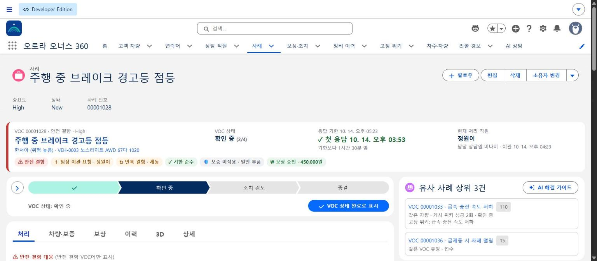

# 대표 사례: 안전 결함 VOC 한 건의 처리와 확인

[프로젝트 소개](../README.md) | [설계와 수용 테스트](PRD.md) | [Flow 원본](../force-app/main/default/flows/VOC_Case_Before_Save.flow-meta.xml)

## 문제 정의

가상의 전기차 고객센터에서 주행 중 브레이크 경고등이 켜졌다는 VOC가 접수됐다고 가정했습니다. 상담원이 차주, 차량, 보증, 정비 기록을 따로 찾고 이관 여부까지 기억해야 한다면 안전 신호가 늦게 전달될 수 있습니다. 이 프로젝트의 출발 질문은 **상담원이 VOC 한 건을 열었을 때 필요한 정보와 다음 처리자를 바로 확인할 수 있는가**였습니다. 실제 고객센터에서 발생한 사건이나 측정한 지연은 아닙니다.

## 제가 정한 처리 기준

1. VOC 유형이 `안전 결함`이면 접수 시 응답 기한을 생성 시각에서 2시간 뒤로 설정합니다. 2시간은 이 가상 업무를 위해 정한 값이며 업계 표준이 아닙니다.
2. 저장 전에 담당 팀장이 지정돼 있는지 확인합니다. 정보가 없으면 저장을 막고 오류 이유를 보여 줍니다.
3. 조건이 갖춰지면 담당 처리자를 팀장으로 바꾸고 이관 상태, 사유, 시각을 기록합니다. 보증 만료 여부가 안전 이관을 막지 않도록 했습니다.
4. AI에는 요약과 답변 초안만 맡깁니다. 이관, 승인, 종결은 Flow와 Apex의 규칙 또는 사람이 처리하도록 범위를 나눴습니다.

이 기준을 선택한 이유는 상담원이 위험 여부를 다시 해석하기 전에 **같은 입력에는 같은 이관 결과**가 나오게 하기 위해서입니다. 보증 정보는 상담에 필요하지만 안전 이관의 선행 조건으로 쓰지 않았습니다.

## 구현 화면과 확인한 결과

| 순서 | 직접 만든 것 | 확인할 자료 |
|---|---|---|
| 접수 | Case에 차량과 차주, VOC 유형, 처리 상태를 연결했습니다. | [빠른 접수와 현황 화면](screenshots/v4.5/02-home-intake-charts.jpg), [설계 원본](PRD.md) |
| 이관 | `VOC_Case_Before_Save`가 안전 결함, 담당 팀장, 이관 사유와 응답 기한을 검사합니다. | [Flow 원본](../force-app/main/default/flows/VOC_Case_Before_Save.flow-meta.xml), [기존 수용 테스트 T4와 T8](PRD.md#10-수용-테스트) |
| 처리 | VOC 화면에 안전 결함, 이관 요청, 보증 상태, 첫 응답과 현재 처리 직원을 함께 표시했습니다. | [VOC 기록 화면](screenshots/v4.5/03-voc-record.jpg), [기존 화면 수용 테스트 D3](PRD.md) |

2026년 10월 14일에 기록한 [v1 수용 테스트](PRD.md#10-수용-테스트)에서는 안전 결함 VOC를 새로 만들었을 때 응답 기한이 생성 후 **2시간**으로 계산되고 팀장 이관 사유가 `안전 결함 우선 처리`로 남는 것을 CLI에서 확인했습니다(T4). 팀장 정보가 없는 이관 대상은 저장이 막히고 레코드가 만들어지지 않았습니다(T8). 위 화면과 테스트는 서로 다른 기존 검증 자료이며, 이 문서를 쓰면서 새로 수행한 테스트는 아닙니다.

## 결과 검토

**사용 제한:** 가상 회사와 시연 데이터, Developer Edition에서 확인한 기능입니다. 실제 상담 속도, 안전 사고 감소, 고객 만족 개선을 측정하지 않았습니다. 화면의 특정 처리 결과를 모든 입력에 대한 보증으로 해석할 수 없습니다.

**앞으로 추진:** 실제 업무에 적용한다면 먼저 안전 유형과 이관 담당자의 기준을 현장과 합의하고, 다음으로 누락 정보와 재이관 같은 예외를 운영 자료로 점검해야 합니다. 마지막으로 실제 접수부터 담당자 확인까지의 시간과 누락 건수를 기준 기간과 비교해야 효과를 말할 수 있습니다. 이 조건이 갖춰지기 전에는 기능 확인 결과로만 제시합니다.
